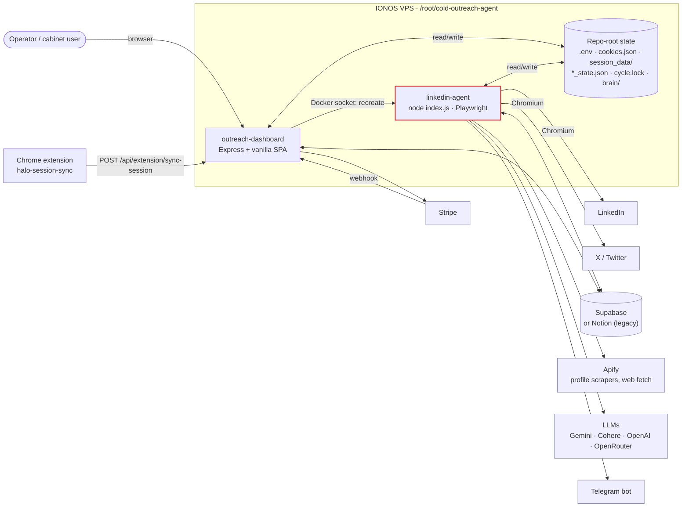
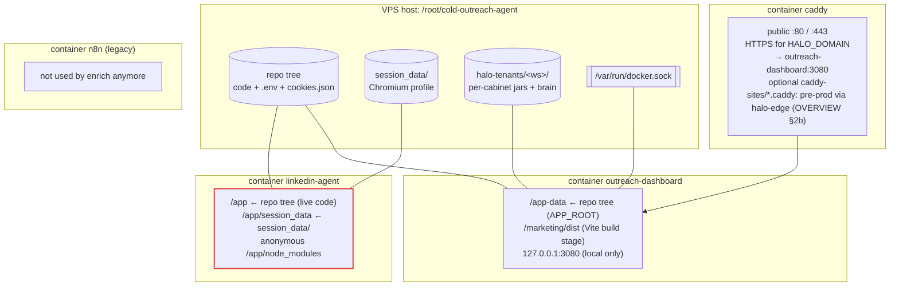
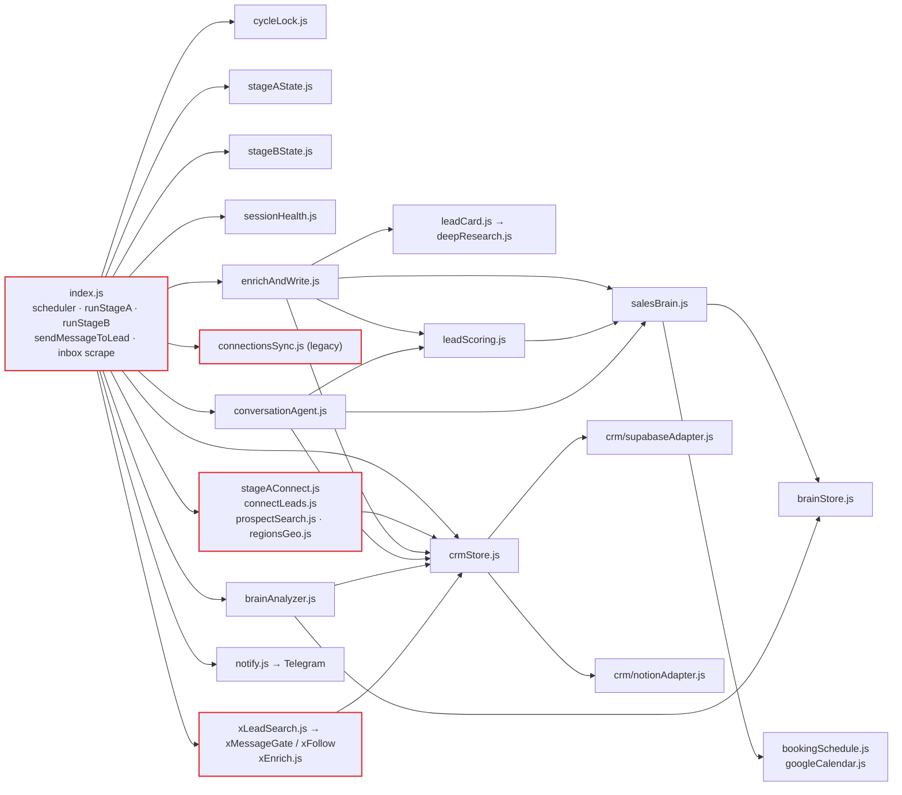

# H.A.L.O. architecture — visual guide

A diagram-first map of how H.A.L.O. works. It complements
[`OVERVIEW.md`](../../OVERVIEW.md), which stays the operational source of truth
(env flags, ops playbook, failure history). Start here to build the mental
model, then go to OVERVIEW for the details.

| Page | What it explains |
|------|------------------|
| **[at-a-glance.md](at-a-glance.md)** | **Start here:** blocks, lead stages and a day in the life, in 5 minutes |
| [pipeline.md](pipeline.md) | The four CRM statuses and which code moves a lead between them |
| [stage-a.md](stage-a.md) | Stage A acquisition: acceptance → leftover ice → connect invites (+ X search) |
| [stage-b.md](stage-b.md) | Stage B conversation: inbox revive → replies → silence closings |
| [brain.md](brain.md) | Prompt composition, the 3-role LLM pipeline, enrich + scoring, weekly analysis, booking |
| [scheduler-session.md](scheduler-session.md) | Scheduler loop, `cycle.lock` priorities, LinkedIn session life cycle |
| [dashboard-tenancy.md](dashboard-tenancy.md) | Express dashboard, auth, tenant-scoped vs platform-shared state |
| [channels-x.md](channels-x.md) | X (Twitter) channel and DeepResearch |

**Legend used in every diagram:** nodes with a **red border** open Chromium
against LinkedIn or X. Those steps fall under the one-browser-at-a-time rule
and can burn the session.

---

## System context

The **agent** and the **dashboard** never call each other over HTTP. They share
the host directory: the dashboard writes `.env`, `tenant.env`, `brain/*` and
`force_run_once.json`, and the agent re-reads them (`reloadEnv()` in
`index.js`) between ticks. To apply a change immediately, the dashboard
recreates the agent container through the Docker socket.

## Deploy topology

Source: [`docker-compose.ionos.yml`](../../docker-compose.ionos.yml). After any
`.env` change the agent must be **recreated**, not restarted
(`docker compose -f docker-compose.ionos.yml up -d --force-recreate linkedin-agent`).

## Module map (top-level)

Rule: everything talks to the CRM through **`crmStore.js`**, never an adapter
directly. `CRM_BACKEND` picks the adapter, and both adapters expose the same shape.
