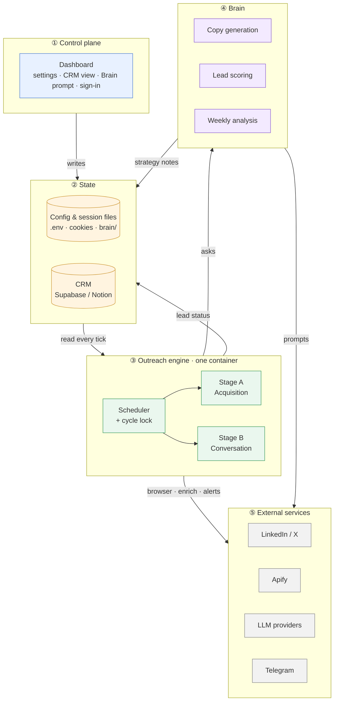
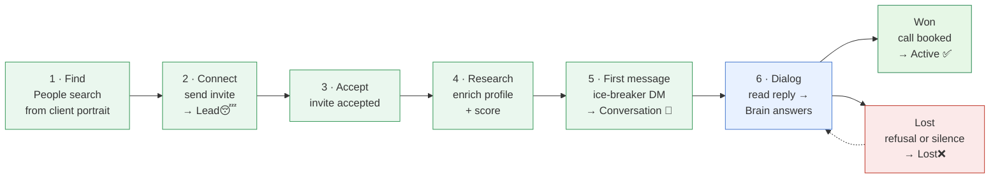
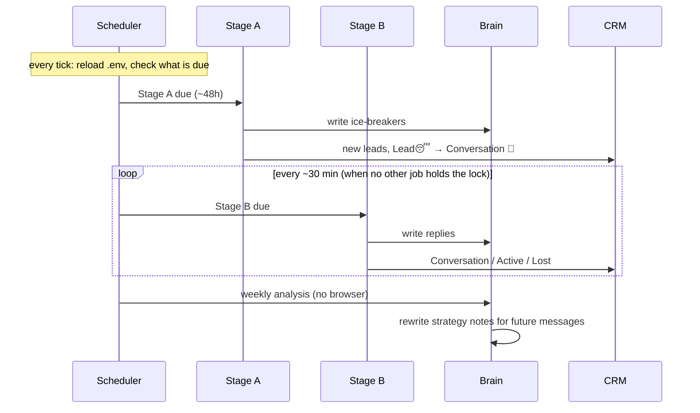

# H.A.L.O. at a glance

A five-minute picture of the system for engineers. It shows blocks and stages
only. Follow the links for the details.

## 1. The building blocks

| Block | Job | Details |
|-------|-----|---------|
| Dashboard | Operator edits settings, prompts, CRM. Never runs outreach itself | [dashboard-tenancy.md](dashboard-tenancy.md) |
| Scheduler | Fires stages on timers. The lock allows one browser at a time | [scheduler-session.md](scheduler-session.md) |
| Stage A | Finds people, sends invites, sends the first message | [stage-a.md](stage-a.md) |
| Stage B | Reads replies, answers, closes silent threads | [stage-b.md](stage-b.md) |
| Brain | Writes every message, scores leads, learns weekly | [brain.md](brain.md) |
| CRM | One row per lead, in one of 4 statuses | [pipeline.md](pipeline.md) |

## 2. The stages a lead goes through

Step 6 repeats until there is an outcome. The dotted arrow means a Lost lead
who writes back returns to the dialog.

Steps **1–5 are Stage A** (green, every ~48h). Step **6 is Stage B** (blue,
every ~30 min). After **Active ✅**, a human takes over.

## 3. How one day looks

## 3 rules every engineer must know

1. **One browser at a time.** Stages never run in parallel, and `cycle.lock` enforces it.
2. **Protect the LinkedIn session.** No auto-login, no `/in/` profile visits for DMs, never save cookies without `li_at`.
3. **Four CRM statuses only**, imported from `crm/constants.js`.

The full list is in `CLAUDE.md` → "Critical safety rules".
