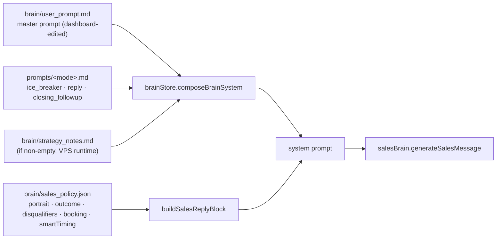
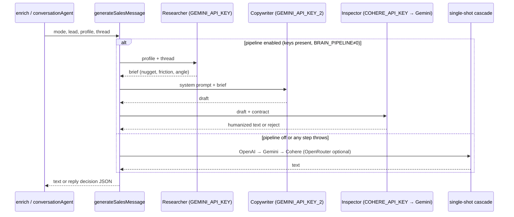
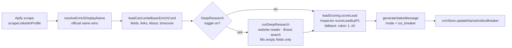
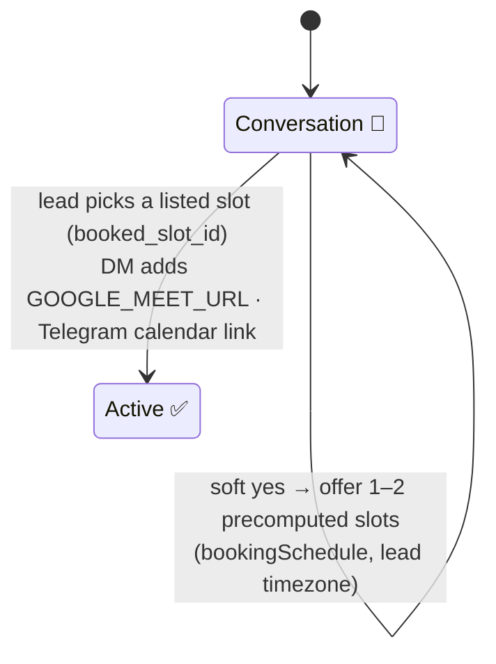
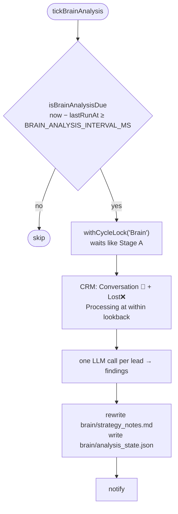

# Brain — copy generation, scoring, analysis

"Brain" is every LLM-facing part of H.A.L.O. Callers (`enrichAndWrite`,
`conversationAgent`) only ever call `generateSalesMessage()` in
[`salesBrain.js`](../../salesBrain.js). Prompt assembly, provider choice and
fallbacks all live behind that one call. Brain never opens LinkedIn.

## Prompt composition

In a cabinet (tenant), every path resolves under `tenantPaths(ws)`. WAFFi's
`default` workspace keeps the legacy root paths.

## 3-role pipeline

## Enrich → score → ice (one call per lead)

Set `LEAD_SCORE_LLM=0` to use the deterministic rubric only. The score is
informational and never changes send order.

## Book-a-call outcome

The LLM never invents times. Slots are computed server-side from
`sales_policy.json → booking`, and about 5 are injected into the reply prompt.

## Weekly strategy analysis

**Never deploy `strategy_notes.md` or `analysis_state.json` from local.** They
are VPS runtime state, and a local copy wipes live analysis.

## Key files

| File | Role |
|------|------|
| `salesBrain.js` | `generateSalesMessage`, `scoreLeadIcpFit`, `scoreLeadFromReply`, pipeline + fallback |
| `brainStore.js` | Paths, `composeBrainSystem`, `readSalesPolicy`, portrait helpers |
| `enrichAndWrite.js`, `leadCard.js` | Enrich orchestration |
| `leadScoring.js` | Rubric + LLM score, reply rescore |
| `brainAnalyzer.js` | `runBrainAnalysis` |
| `brainLlmHealth.js` | Provider health surfaced in the dashboard |
| `bookingSchedule.js`, `googleCalendar.js` | Slots, calendar link |
