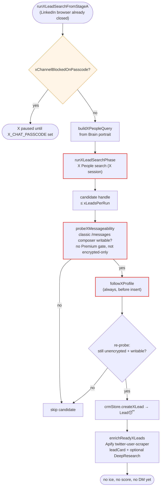
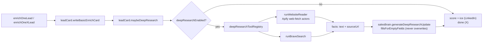

# Channels: X (Twitter) and DeepResearch

## Channel routing

There is no channel column in the CRM. `leadChannel.js` (`channelFromUrl`)
infers the channel from the lead's `Link`: `linkedin.com` → LinkedIn,
`x.com` / `twitter.com` → X. Stage A's LinkedIn ice loop skips X leads.

| Flag | Effect |
|------|--------|
| `CHANNEL_LINKEDIN_ENABLED=0` | Stage A skips LinkedIn entirely and runs only the X phase |
| `CHANNEL_X_ENABLED=1` | X phase runs at the end of Stage A, after the LinkedIn browser closes |

## X phase (current scope: find, follow, enrich)

- **X DMs are not wired into Stage A/B yet.** `xSend.js` `sendXDm` exists but
  has no caller in the agent or dashboard.
- X state is fully isolated: `xSessionHealth.js` (own status file and cookies),
  `xSessionRepairWorker.js` (dashboard X sign-in), `xPasscode.js` (encrypted-chat
  passcode state). None of them write `cookies.json`, `session_status.json` or
  `SKIP_STAGE_*`.
- X Chromium work still counts toward the one-browser rule and runs inside the
  Stage A lock.

## DeepResearch

Tools **never open the lead's main Link**, which keeps the LinkedIn/X session
out of it. An empty registry still completes the step, so scoring and ice
continue.

## Key files

| File | Role |
|------|------|
| `leadChannel.js` | Channel inference from URL |
| `xLeadSearch.js` | `runXLeadSearchPhase`, `buildXPeopleQuery` |
| `xMessageGate.js` | `probeXMessageability` |
| `xFollow.js` | `followXProfile` |
| `xEnrich.js` | `enrichReadyXLeads`, `enrichOneXLead` |
| `xSend.js` | `sendXDm` (not yet called) |
| `xSessionHealth.js`, `xSessionRepairWorker.js`, `xPasscode.js` | Isolated X session state |
| `leadCard.js`, `deepResearch.js`, `deepResearchTools.js` | Enrich card + DeepResearch |
