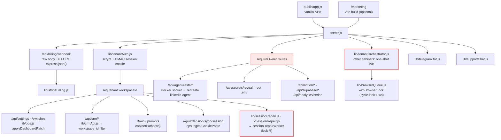
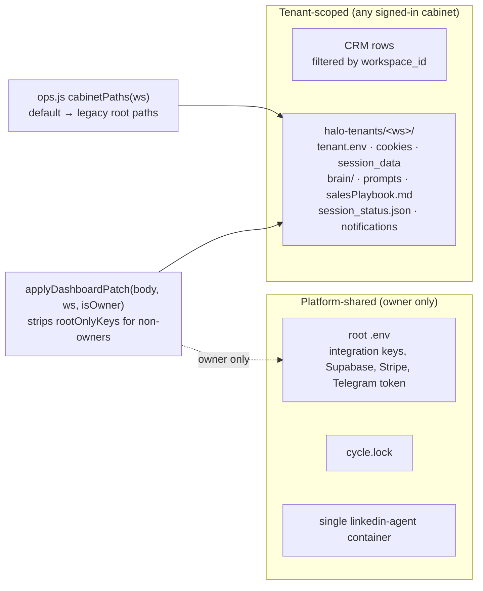
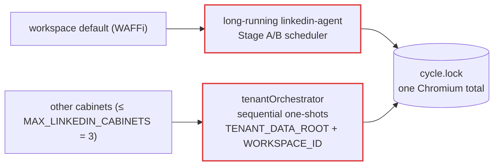
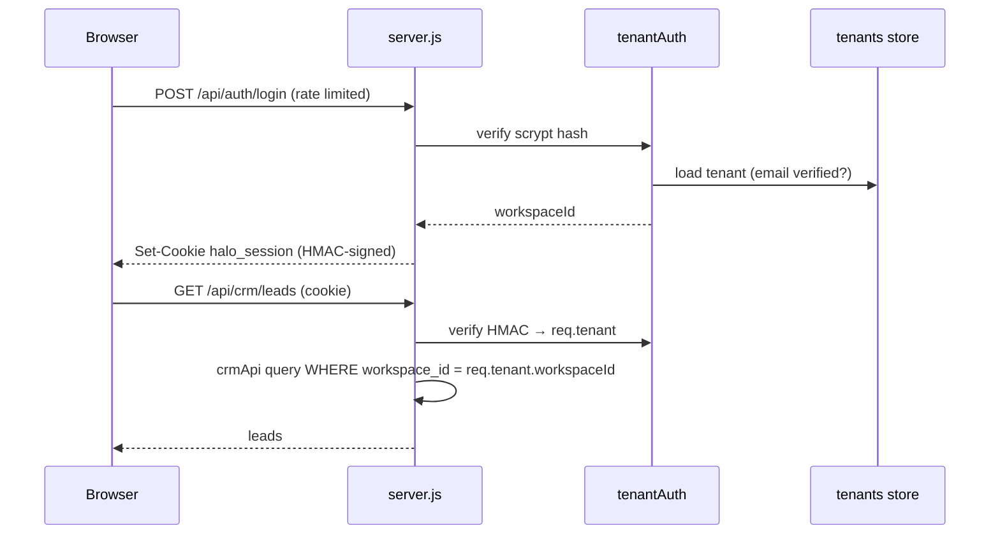

# Dashboard and multi-tenancy

The dashboard is a bare Express server ([`dashboard/server.js`](../../dashboard/server.js))
plus a hand-written vanilla SPA (`dashboard/public/app.js`). It is the control
plane: it edits settings, Brain and CRM, and restarts the agent. It never
drives LinkedIn itself, except for session repair under lock `R`.

## Components

## What is tenant-scoped and what is shared

- `cabinetPaths()` in `dashboard/lib/ops.js` is the **only** place that maps a
  workspace to files. WAFFi is `default` and keeps the legacy root paths.
- `/api/settings` is open to every cabinet because it only writes
  cabinet-scoped files. Any new setting that touches shared state must go into
  the `rootOnlyKeys` guard.
- New cabinets are seeded by `ensureTenantRuntime` with a **neutral** prompt,
  never a copy of WAFFi's master prompt.

## Who actually runs outreach

## Sign-in request

Full auth matrix: OVERVIEW §9 "Auth & authorization".
