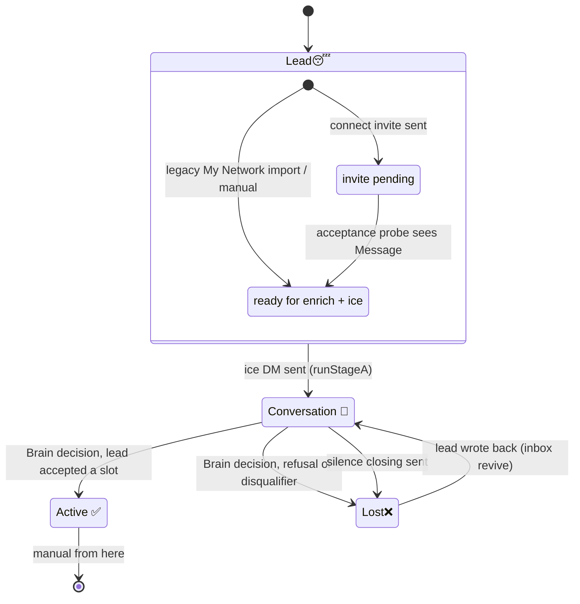
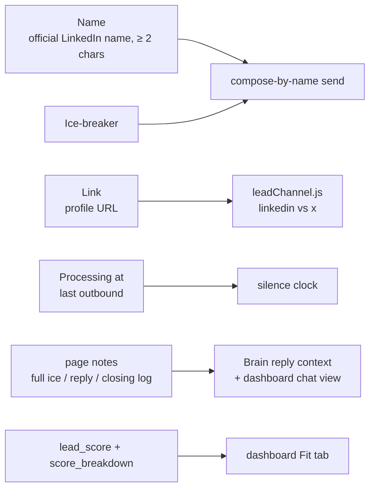

# CRM pipeline — the four statuses

Every lead is in exactly one of four statuses, defined in
[`crm/constants.js`](../../crm/constants.js) (`CRM_STATUSES`). The emoji are
part of the value. Import the constants and never retype the literals.

| Constant | Value | Owner |
|----------|-------|-------|
| `STATUS_LEAD` | `Lead😴` | Stage A: invite pending, accepted and waiting for ice, or manual queue |
| `STATUS_CONVERSATION` | `Conversation 💬` | Stage B: ice sent, dialog in progress |
| `STATUS_ACTIVE` | `Active ✅` | Human: outcome met, automation stops touching it |
| `STATUS_LOST` | `Lost❌` | Stage B: refused or silent, can be revived |

> The old `Proposal 1️⃣` / `Proposal 2️⃣` statuses no longer exist.
> `normalizeCrmStatus()` maps them forward (`Proposal 1️⃣ → Lead😴`,
> `Proposal 2️⃣ → Conversation 💬`), and `STATUS_PROPOSAL_1/2` survive only as
> deprecated aliases. An accepted invite now **stays `Lead😴`** and gets the
> `LEAD_READY_MARKER` note (`"ready for enrich + ice"`).

## State machine

## Who writes each transition

| Transition | Trigger | Code |
|------------|---------|------|
| new → `Lead😴` (pending) | Connect invite sent from Brain portrait search | `stageAConnect.js` → `connectLeads.js` `upsertLeadSleepPage` → `crmStore.createLeadSleep` |
| new → `Lead😴` (ready) | Legacy My Network sync | `connectionsSync.js` `createNotionLead` |
| new → `Lead😴` (X) | X search found a messageable profile | `xLeadSearch.js` → `crmStore.createXLead` |
| pending → ready | Acceptance phase | `stageAConnect.js` `runStageAAcceptancePhase` → `crmStore.promoteLeadSleepToProposal1` (legacy name, adds the ready marker) |
| stale pending → archived | Invite never accepted | `connectLeads.js` `expireStaleLeadSleepPages` |
| `Lead😴` → `Conversation 💬` | Ice DM sent | `index.js` `runStageA` → `sendIceAndPromote` (`setProcessingAt` + `updateNotionStatus`) |
| `Conversation 💬` → `Active ✅` / `Lost❌` / stay | LLM reply decision | `conversationAgent.js` `decideReplyForLead` → `salesBrain.generateSalesMessage` |
| `Conversation 💬` → `Lost❌` | No reply for `SILENCE_BUSINESS_DAYS` | `index.js` `runStageB` silence loop + `craftClosingFollowup` |
| `Lost❌` → `Conversation 💬` | Unread inbound from a Lost lead | `index.js` `runStageB` inbox name-revive |

## Fields the pipeline relies on

Stage B ignores `Lead😴`, and nothing touches `Active ✅` automatically.
