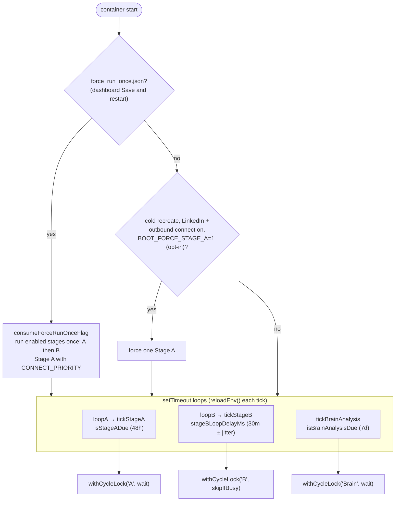
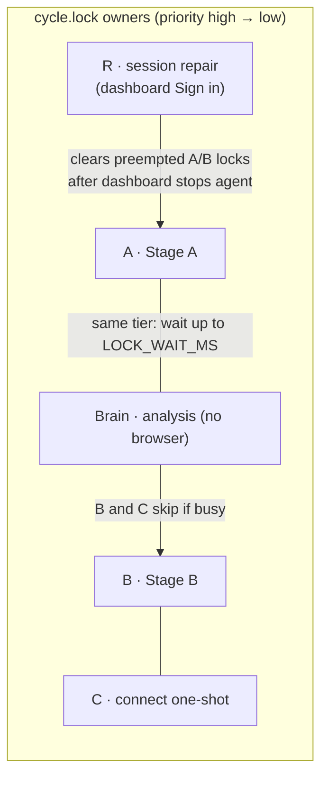
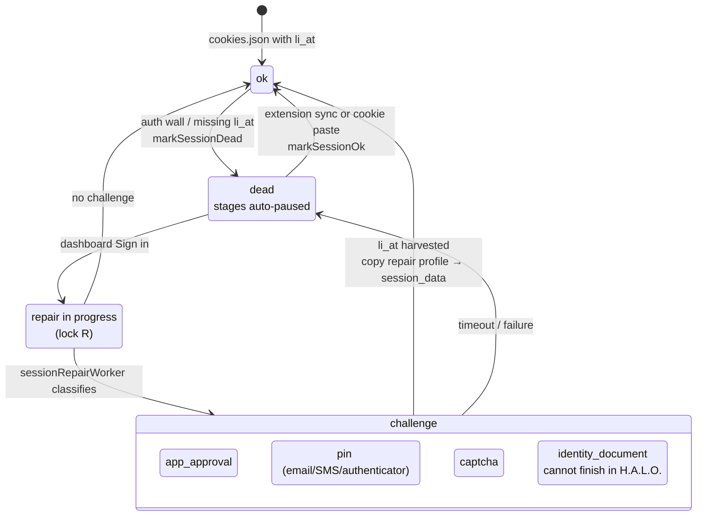

# Scheduler, cycle lock and LinkedIn session

The agent is one long-running Node process (`node index.js`) with three
self-rescheduling loops. They coordinate through `cycle.lock` so that only
**one Chromium-bearing job runs at a time**. This is the most important
invariant in the system.

## Scheduler loop

`reloadEnv()` re-reads `.env` between ticks, so most dashboard settings apply
without a restart. Container-level env still needs `--force-recreate`.

## Cycle lock

| Behavior | Detail |
|----------|--------|
| Wait vs skip | `A` and `Brain` wait (`skipIfBusy: false`). `B` and `C` skip the tick |
| Stale | A lock older than `LOCK_STALE_MS` (3h) is cleared |
| Multi-cabinet | `dashboard/lib/browserQueue.js` `withBrowserLock` extends the same lock with `workspaceId` |
| Files | `cycleLock.js`, `cycle.lock` (gitignored) |

Never add a code path that opens a second browser in parallel. That includes
probe browsers "just to check" the session.

## LinkedIn session life cycle

On `markSessionDead`, `sessionHealth.js` snapshots which stages were on into
`stagesPausedBySession` and writes `SKIP_STAGE_A=1`, `SKIP_STAGE_B=1`,
`SKIP_CONVERSATION=1`, `OUTREACH_PAUSED=1`. `markSessionOk` restores exactly
that snapshot. A Telegram notification fires on each transition.

## Session rules (from production incidents)

1. `ALLOW_AUTO_LOGIN` stays `0`. Password login from the VPS kicks the operator's real browser.
2. `persistSessionCookies` skips the write when the live context has no `li_at`.
3. Never open `/in/` profiles to DM.
4. After a fresh cookie paste, wipe the old Chromium cookie DB in `session_data/`.
5. X has its own isolated health (`xSessionHealth.js`) and never touches LinkedIn's files.

Full list of known `li_at` kill causes: OVERVIEW §7.
