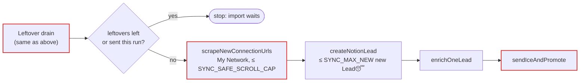

# Stage A — acquisition

Stage A turns accepted invites into first DMs and refills the funnel with new
connection invites. It runs every `STAGE_A_INTERVAL_MS` (default 48h) under
`cycle.lock` owner `A`. Entry point: `runStageA()` in
[`index.js`](../../index.js).

## Flow (portrait prospecting ON, the default)

```mermaid
flowchart TD
  classDef li stroke:#d33,stroke-width:2px
  classDef guard fill:#fff4e5,stroke:#e0a040

  Start(["tickStageA / processLeads"]) --> Lock["withCycleLock('A')<br/>waits up to LOCK_WAIT_MS"]
  Lock --> G1{"OUTREACH_PAUSED=1<br/>or SKIP_STAGE_A=1?"}:::guard
  G1 -->|yes| Stop1(["skip"])
  G1 -->|no| G2{"CHANNEL_LINKEDIN_ENABLED=0?"}:::guard
  G2 -->|yes| XOnly["X search + enrich only<br/>runXLeadSearchFromStageA"]:::li --> Stop1
  G2 -->|no| G3{"session_status ok?"}:::guard
  G3 -->|no| Stop1
  G3 -->|yes| Browser["ensureLoggedInBrowser<br/>persistent Chromium + cookies.json"]:::li

  Browser --> Expire["expireStaleLeadSleepPages"]
  Expire --> Accept["0a · Acceptance<br/>runStageAAcceptancePhase<br/>probe Lead😴 profiles → add ready marker"]:::li

  Accept --> Prio{"STAGE_A_CONNECT_PRIORITY=1?<br/>(Save and restart boot)"}
  Prio -->|yes| Connect
  Prio -->|no| Drain

  subgraph Drain["0b · Leftover drain (each ice-ready Lead😴, LinkedIn only)"]
    direction TB
    HasIce{"real ice-breaker?"} -->|no| Pause["close browser<br/>pauseBrowserForEnrich"] --> Enrich["enrichOneLead<br/>Apify → card → DeepResearch → score → ice"] --> Resume["resumeBrowserForSend"]:::li
    HasIce -->|yes| Timing
    Resume --> Timing{"Smart Timing on and<br/>outside lead's window?"}
    Timing -->|yes| Defer["defer to next run"]
    Timing -->|no| Send["sendMessageToLead<br/>/messaging/compose by name"]:::li
    Send --> Promote["Processing at = now<br/>Lead😴 → Conversation 💬<br/>append ice to notes"]
  end

  Drain --> Left{"ice-ready leftovers remain<br/>or leftover ice sent this run?"}
  Left -->|yes| SkipConn["skip connect this run<br/>(OVERVIEW §12 rule)"]
  Left -->|no| Connect["1 · Connect<br/>runStageAConnectPhase<br/>Brain portrait People search<br/>≤ CONNECT_MAX_PER_RUN invites → new Lead😴"]:::li

  Connect --> Summary
  SkipConn --> Summary["[Stage A SUMMARY] + Telegram notes"]
  Summary --> Mark{"no ice-ready leftovers<br/>and session alive?"}
  Mark -->|yes| Ran["markStageARan<br/>(starts 48h clock)"]
  Mark -->|no| NoMark["leave due → retries next tick"]
  Ran --> Close
  NoMark --> Close["persistSessionCookies (only if live li_at)<br/>closeBrowser"]
  Close --> XAfter{"CHANNEL_X_ENABLED=1?"}
  XAfter -->|yes| XRun["runXLeadSearchFromStageA<br/>after LinkedIn browser is closed"]:::li
  XAfter -->|no| Done(["release lock"])
  XRun --> Done
```

### Why the connect phase gets skipped

A Stage A run that already sent leftover ice **does not** go on to send new
invites. That would be a second long Chromium lifetime on a datacenter IP,
which kills `li_at` (OVERVIEW §12, CLAUDE.md safety rule #5). The exception is
the Save-and-restart boot (`STAGE_A_CONNECT_PRIORITY=1`): it runs connect first
and defers the leftover ice.

### Why the browser closes for enrich

Apify enrich takes minutes. An idle Chromium with keep-alive traffic during
that time has burned sessions in production, so `pauseBrowserForEnrich`
closes it and `resumeBrowserForSend` reopens it for the DM.

## Legacy mode (portrait prospecting OFF)

Enabled with `STAGE_A_LEGACY_SYNC=1` (portrait prospecting off). One-shot
variants: `ENRICH_ONLY=1`, `SYNC_CONNECTIONS_ONLY=1`, `SKIP_SEND=1`. See
OVERVIEW §4 and §8.

## Key files

| File | Function | Role |
|------|----------|------|
| `index.js` | `runStageA`, `sendMessageToLead`, `persistSessionCookies` | Orchestration and DM send |
| `stageAConnect.js` | `runStageAAcceptancePhase`, `runStageAConnectPhase` | Acceptance probes, outbound invites |
| `prospectSearch.js`, `regionsGeo.js` | — | People-search URL from the Brain portrait |
| `connectLeads.js` | `expireStaleLeadSleepPages`, `archiveLeadSleepDuplicates` | `Lead😴` upkeep |
| `enrichAndWrite.js` | `enrichOneLead`, `hasRealIceBreaker` | Apify + score + ice |
| `stageAState.js` | `isStageADue`, `markStageARan` | Interval clock (`stage_a_state.json`) |
| `timezoneResolver.js` | `isWithinSendWindow` | Smart Timing gate |

## Safety rules that apply

- Never open `/in/` profiles to DM. Compose by name via `/messaging/compose`.
- Never persist cookies without a live `li_at`.
- Leftover ice and new imports/connects never share one run (unless connect-priority boot).
- Only one Chromium-bearing job at a time. The X phase runs **after** the LinkedIn browser closes.
