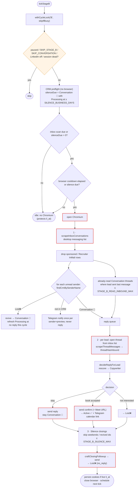
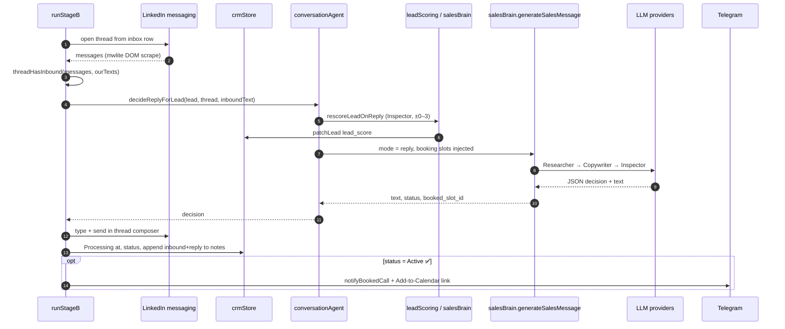

# Stage B — conversation

Stage B keeps dialogs going. It revives `Lost❌` leads who wrote back, replies
to `Conversation 💬` threads, and closes silent ones. It ticks every
`STAGE_B_INTERVAL_MS` (default 30m, min 6m in the UI) plus ±1–5 min jitter,
under `cycle.lock` owner `B` with `skipIfBusy: true`. It skips the tick if
Stage A holds the lock. Entry point: `runStageB()` in [`index.js`](../../index.js).

## Flow

The order is strict: revive → reply → silence. A revived lead gets its reply
on the **next** cycle, so one cycle never revives and replies to the same
thread.

## One reply, end to end

## Key files

| File | Function | Role |
|------|----------|------|
| `index.js` | `runStageB`, `scrapeInboxConversations`, `collectUnreadP2Leads` | Orchestration, inbox scrape |
| `conversationAgent.js` | `decideReplyForLead`, `craftClosingFollowup`, `threadHasInbound`, `namesMatch` | Reply logic |
| `leadScoring.js` | `rescoreLeadOnReply`, `heuristicReplyRescore` | Reply-time score update (fail-open) |
| `bookingSchedule.js`, `googleCalendar.js` | — | Precomputed slots, calendar link |
| `stageBState.js` | `isInboxScanDue`, `canOpenBrowser`, `ensureStageBScheduled` | Jittered cadence (`stage_b_state.json`) |

## Safety rules that apply

- Threads are opened **from the inbox list**, never by visiting `/in/` profiles
  (`STAGE_B_SCAN_ALL_P2=1` exists for debugging only).
- Unknown senders are never auto-replied.
- Abort on auth wall, and mark the session dead instead of retrying.
